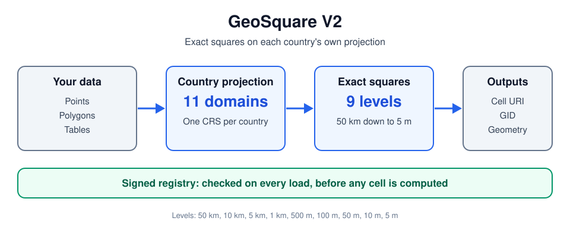

# GeoSquare V2



GeoSquare V2 turns points, lines, polygons and tables into exact metric squares. Each square has a stable ID. Each country uses its own projection, so the squares stay square on the ground.

It covers 11 ASEAN domains: `BN`, `KH*`, `ID`, `LA`, `MM*`, `MY`, `PH`, `SG`, `TH*`, `TL*`, and `VN*`.

`*` marks a provisional technical profile. It has no production guarantee. See [country profiles](docs/country-profiles.md).

## What it is

- A grid of square cells, from level 0 (a 50,000 km root) to level 14 (5 m cells).
- A cell identity of `(domain, level, x, y)`. The GID and the geometry come from that identity.
- A signed registry of country profiles. The loader checks the signature before any cell is computed.
- A Python package for converting points, polygons and tables, and for aggregating values per cell.

## Why use it

- **Square on the ground.** Each country has its own projected coordinate system. [Comparison with S2, H3, geohash and Web Mercator](docs/comparison.md).
- **Stable IDs.** Store the URI (`geosquare:v2:<domain>:<gid>`), not the bare GID. Datasets written with 1.0.0 still load. For some points in LA and VN, the GID differs from the current profile, and the reader warns. See [profile compatibility](docs/profile-compatibility.md).
- **Explicit aggregation.** You choose the rule for each column, such as sum, mean or weighted mean. See [data and aggregation](docs/data-and-aggregation.md).
- **Errors, not guesses.** Invalid coordinates raise an error.

## Install

The package is on PyPI as `geosquare-v2`. The import name is `geosquare_v2`. Python 3.11 or newer is required.

```zsh
python -m pip install "geosquare-v2[registry]"
```

For a source checkout:

```zsh
python -m pip install -e ".[registry]"
```

Add extras only when you need them, such as `geo`, `table` or `s3`. The [optional dependencies table](docs/README.md#optional-dependencies) lists them.

## Quick start

The example reads the trust file in `release/`, so run it from a checkout:

```zsh
python -m pip install -e ".[registry]"
python examples/quickstart.py
```

Output from the 1.3.0 checkout:

```text
URI: geosquare:v2:ID:H2X545V39
GID: H2X545V39
Projected bounds: ProjectedBounds(min_x=-1233000.0, min_y=-409000.0, max_x=-1232000.0, max_y=-408000.0)
Cell edge (m): 1000.0
Profile version: 2.2.0-explicit-datum
Maximum scale error (%): 0.6070515705397517
```

The core call, after the registry is loaded as shown in `examples/quickstart.py`:

```python
cell = service.point_to_cell("ID", longitude=106.8456, latitude=-6.2088, level=9)
print(cell.uri)  # geosquare:v2:ID:H2X545V39
```

Production code must manage its own trusted public keys. The key file in `release/` is an example.

More examples are in [docs/quickstart.md](docs/quickstart.md).

## How the parts fit

| Repository | Job |
|---|---|
| geosquare-v2 (this repo) | The spec, country profiles and the Python package. It sets the rules. |
| [geosquare-engine](https://github.com/geosquareai/geosquare-engine) | A fast Rust core with Python, WebAssembly, DuckDB and `gsq` CLI bindings. It follows the rules in this repo. |
| [geosquare-platform](https://github.com/geosquareai/geosquare-platform) | A server API. It accepts CSV, checks each row, stores cell datasets, and answers queries and exports. Its docs are in Bahasa Indonesia. |

## Documentation

- [Documentation index](docs/README.md)
- [Concepts](docs/concepts.md)
- [Quick start](docs/quickstart.md)
- [Service API](docs/service-api.md) and [full API guide](docs/api.md)
- [Data and aggregation](docs/data-and-aggregation.md)
- [Time cube](docs/time-cube.md)
- [Dataset metadata](docs/dataset-metadata.md)
- [Crosswalk format](docs/crosswalk-format.md)
- [Licenses](docs/data-licenses.md)

## Contributing and security

- [Contributing](CONTRIBUTING.md)
- [Security policy](SECURITY.md). Do not report vulnerabilities in public issues.

## License

The code is licensed under Apache-2.0. Boundary data has its own licenses. See [licenses](docs/data-licenses.md).
